# Metodologia e Estrutura do TCC: Diagrama de Ponta a Ponta

Este documento consolida o **Diagrama Metodológico de Ponta a Ponta** e o detalhamento técnico de todas as etapas do Trabalho de Conclusão de Curso (TCC). O fluxo representa o pipeline científico e computacional efetivamente implementado e auditável no repositório `tcc-urbs`.

---

## 1. Diagrama Geral do Pipeline Metodológico

O fluxo integra desde os procedimentos iniciais de tramitação e autorização com a URBS até a disponibilização dos diagnósticos em uma plataforma web operacional de monitoramento em tempo real.

```mermaid
flowchart TD
    %% ESTÁGIO 1: TRÂMITES E AUTORIZAÇÃO
    subgraph S1["1. Tramitação Institucional e Acesso a Dados"]
        direction TB
        A1["Contato Institucional com a URBS<br/>• Envio de e-mails técnicos e ofício acadêmico<br/>• Articulação com gestores da RIT"] --> A2["Liberação de Acesso e Endpoints<br/>• Catálogo de dados abertos da URBS<br/>• Dicionário de dados operacionais (SCO)"]
        A2 --> A3["Mapeamento do Modelo de Dados<br/>• Telemetria dinâmica em tempo real<br/>• Cadastro estático de planejamento (C3SL/URBS)"]
    end

    %% ESTÁGIO 2: AQUISIÇÃO E COLETA
    subgraph S2["2. Aquisição e Coleta Contínua de Dados"]
        direction TB
        B1["Script Coletor Autônomo em Python<br/>(Operação 24/7 com tolerância a falhas e rate-limiting)"]
        B2["Telemetria Dinâmica (GPS)<br/>• Regime A: Amostragem Padrão (~120s, 5,08M pings)<br/>• Regime B: Alta Frequência (~20s, ~17k eventos L. 541)"]
        B3["Dados Cadastrais e Estáticos (C3SL / URBS)<br/>• Paradas e Itinerários (pontosLinha)<br/>• Horários Programados (tabelaLinha)<br/>• Traçado Físico da Malha (shapeLinha)"]
        B1 --> B2
        B1 --> B3
        B2 --> B4["Armazenamento em Disco<br/>(CSVs particionados por dia e hora)"]
    end

    %% ESTÁGIO 3: ETL E ENGENHARIA DE EVENTOS
    subgraph S3["3. ETL e Engenharia do Log de Eventos (Reconstrução)"]
        direction TB
        C1["Pré-processamento e Limpeza Bruta<br/>(Remoção de nulos, garagens/REC, duplicatas e jitter < 5m)"]
        C2["Filtro Geoespacial Baseado no Shape<br/>(Descarte de outliers a > 500m do traçado contínuo da via)"]
        C3["Segmentação de Viagens (Cases)<br/>(Agrupamento por veículo/dia/tabela, corte por inversão SENT/gap > 10m)"]
        C4["Map Matching Probabilístico HMM (Viterbi)<br/>(Projeção ortogonal no shape penalizando emissão σ e transição β)"]
        C5["Interpolação Temporal com Spline PCHIP<br/>(Garantia de monotonicidade temporal dt/ds ≥ 0, sem overshoot)"]
        C6["Validação de Proximidade (Geofence 150m)<br/>(Distância mínima observada ≤ 150m; senão OMITIR evento do log)"]
        C7["Padronização de Chaves Canônicas e Qualidade<br/>• Atividade: PASSAGEM_{SEQ}_{NOME}<br/>• Flag 'interpolated' e Taxa de Censura Operacional"]
        C1 --> C2 --> C3 --> C4 --> C5 --> C6 --> C7
        C7 --> C8["Exportação Padronizada<br/>(Arquivos XES padrão IEEE 1849 e CSVs relacionais)"]
    end

    %% ESTÁGIO 4: MINERAÇÃO DE PROCESSOS
    subgraph S4["4. Mineração de Processos (PM4Py Engine)"]
        direction TB
        D1["Descoberta de Processos (Process Discovery)<br/>• Algoritmo Inductive Miner<br/>• Redes de Petri com transições silenciosas (τ) para desvios"]
        D2["Verificação de Conformidade (Conformance Checking)<br/>• Token-Based Replay (TBR)<br/>• Modelo normativo da URBS vs. Execução Real<br/>• Cálculo de Trace Fitness e Ranking de Paradas Puladas"]
        D3["Mineração de Desempenho (Performance Mining)<br/>• Grafo Diretamente-Seguido (DFG)<br/>• Anotação de tempos médios/medianos entre paradas<br/>• Mapeamento de gargalos estruturais e atrasos operacionais"]
    end

    %% ESTÁGIO 5: DASHBOARD E APLICAÇÃO
    subgraph S5["5. Plataforma Integrada de Auditoria Operacional (Dashboard CCO)"]
        direction TB
        E1["Backend REST e Processamento Assíncrono<br/>(FastAPI, streaming de progresso via Server-Sent Events - SSE)"]
        E2["Módulo Macro: Auditoria Diária CCO<br/>(Classificação Conforme/Atenção/Crítico da frota, taxas globais)"]
        E3["Módulo Micro: Inspetor de Conformidade e Desempenho<br/>(Drill-down por linha/viagem, visualização de Petri Nets e DFGs com zoom)"]
        E4["Replay Geoespacial 4D em Alta Resolução<br/>(Deck.gl v9 TripsLayer + TextLayer sobre traçado físico com slider temporal)"]
        E1 --> E2
        E1 --> E3
        E1 --> E4
    end

    %% RELACIONAMENTO ENTRE MACROESTÁGIOS
    S1 ==> S2
    S2 ==> S3
    S3 ==> S4
    S4 ==> S5
```

---

## 2. Detalhamento Técnico das 5 Macroetapas

### Etapa 1: Tramitação Institucional e Acesso a Dados
- **Objetivo:** Estabelecer a base formal para aquisição das informações oficiais do transporte público de Curitiba.
- **Ações Realizadas:**
  - Envio de correspondência eletrônica e solicitação institucional formal junto aos setores de tecnologia e planejamento da URBS;
  - Levantamento do catálogo de dados abertos e compreensão dos contratos dos serviços web mantidos pela empresa pública;
  - Identificação e mapeamento dos endpoints de dados abertos da URBS:
    - Telemetria dinâmica: `getVeiculos.php`;
    - Cadastro estático: `getLinhas.php`, `getPontosLinha.php`, `getTabelaLinha.php` e `getShapeLinha.php`.
- **Integração com C3SL:** Utilização de backups históricos mantidos e arquivados pelo Centro de Computação Científica e Software Livre (C3SL) da UFPR, complementados com rotinas de contingência (*fallback*) consultando a API da URBS em tempo real.

---

### Etapa 2: Aquisição e Coleta Contínua de Dados
- **Objetivo:** Capturar séries temporais representativas da movimentação da frota com diferentes frequências de amostragem.
- **Componente:** Módulo autônomo `src/coleta/coletor_urbs.py` operando 24 horas por dia, 7 dias por semana, com mecanismo de persistência tolerante a falhas transitórias de conexão.
- **Regimes Operacionais Comparados:**
  - **Regime A (Amostragem Padrão da Rede):** 
    - Intervalo nominal: ~120 segundos (2 minutos);
    - Coleta contínua: de 24/10/2025 às 02:32:48 a 29/10/2025 às 12:29:23 (~130 horas ininterruptas);
    - Volume: **5.082.166 registros brutos** de GPS de toda a frota municipal, particionados em 127 arquivos CSV horários.
  - **Regime B (Alta Frequência Operacional):**
    - Intervalo nominal: ~20 segundos;
    - Coleta contínua: de 02/12/2025 às 00:03:05 a 08/12/2025 às 23:27:09 (~167 horas / 7 dias);
    - Volume: Amostragem de alta taxa consolidada em logs de eventos estruturados (e.g., 16.822 eventos e 1.200 viagens completas para a linha 541).

---

### Etapa 3: ETL e Engenharia do Log de Eventos (Reconstrução de Trajetórias)
- **Objetivo:** Sanear dados brutos e reconstruir trajetórias contínuas para a geração de eventos discretos e matematicamente válidos.
- **Módulos do Pipeline (`src/etl/`):**
  1. **Higienização de Telemetria (`clean_telemetry`):** Expurgo de registros nulos, exclusão de movimentação interna de garagem (`SITUACAO == 'REC'`), supressão de pings estacionários (*jitter* < 5m) e descarte de duplicatas exatas.
  2. **Filtro de Outliers com Restrição no Shape:** Validação geométrica da distância ortogonal do ping contra a malha vetorial contínua (`shapeLinha`). Leituras com distância $> 500\text{ m}$ são eliminadas, evitando o falso descarte de pings em vias expressas sem paradas próximas.
  3. **Segmentação Semântica de Viagens (*Cases*):** Particionamento cronológico das trajetórias por veículo, data e tabela de serviço, com quebra por inversão do sentido operacional (`SENT`) ou janelas de inatividade temporal superior a 10 minutos.
  4. **Map Matching com Hidden Markov Model (HMM - Viterbi):** Projeção espacial das coordenadas ruidosas sobre os vértices do traçado viário físico oficial, penalizando erro de medição do GPS ($\sigma_z = 30\text{m}$) e divergência em relação ao deslocamento viário ($\beta = 50\text{m}$), segundo a formulação de Newson e Krumm (2009).
  5. **Interpolação Temporal Monotônica (PCHIP):** Estimação do instante exato de passagem na coordenada curvilínea de cada parada através de splines hermitianos cúbicos com restrição de monotonicidade estrita ($dt/ds \ge 0$), eliminando aberrações de causalidade temporal e *overshoots*.
  6. **Limiar de Geocerca (150m) e Detecção de Omissões:** Caso a distância mínima observada do ônibus em relação ao ponto fixo de parada exceda 150 metros, o evento é **propositalmente omitido do log**, garantindo que o módulo de conformidade detecte a parada pulada.
  7. **Chaves Canônicas e Taxa de Censura Operacional:** Padronização das atividades como `PASSAGEM_{SEQ:02d}_{NOME}`, rotulação de incerteza de medição com a flag `interpolated: bool` e descarte sistemático de viagens corrompidas com mais de 90% de pontos interpolados.
  8. **Exportação Padronizada:** Gravação dos arquivos finais em formato relacional CSV e no padrão internacional **IEEE 1849-2016 (OpenXES)** em `data/dados_processados/`.

---

### Etapa 4: Mineração de Processos (Motor PM4Py)
- **Objetivo:** Descobrir, auditar e quantificar os fluxos operacionais reais da frota de transporte.
- **Técnicas Empregadas (`src/mining/`):**
  - **Descoberta de Processos (*Process Discovery*):** Aplicação do algoritmo **Inductive Miner** (`discover_petri_net_inductive`) para geração de Redes de Petri, revelando o comportamento real e a emergência de transições silenciosas ($\tau$) criadas automaticamente para representar atalhos e desvios de rota.
  - **Verificação de Conformidade (*Conformance Checking*):** Execução do algoritmo de **Token-Based Replay (TBR)** do log empírico contra o modelo normativo sequencial oficial prescrito pela URBS. Produção do índice de fidelidade (*Trace Fitness*, de 0.0 a 1.0) e do ranking quantitativo de paradas puladas por linha e veículo.
  - **Mineração de Desempenho (*Performance Mining*):** Construção do Grafo Diretamente-Seguido de Desempenho (**Performance DFG**), annotando durações médias e medianas de trânsito em cada arco viário, isolando gargalos estruturais e quantificando atrasos frente à tabela horária programada.

---

### Etapa 5: Plataforma Integrada de Auditoria Operacional (Dashboard CCO)
- **Objetivo:** Fornecer aos fiscais e gestores da URBS uma ferramenta interativa e visual de auditoria ativa e tomada de decisão.
- **Arquitetura e Recursos (`src/visualization/`):**
  - **Backend Reativo em FastAPI:** Serviços REST de alta velocidade integrados ao PM4Py, equipados com streaming *Server-Sent Events* (SSE) na rota `/api/process-stream` para execução de mineração sob demanda com rastreamento visual de progresso.
  - **Painel Macro (Auditoria Diária CCO):** Tabela de governança executiva com classificação automática das linhas em três níveis de criticidade (**Conforme**, **Atenção** e **Crítico**), consolidando indicadores globais de frotas e violações de itinerário.
  - **Painel Micro (Inspetor de Conformidade e Descoberta):** Análise detalhada por veículo e viagem com drill-down investigativo, acompanhada de visualização vetorial interativa de Redes de Petri e DFGs de desempenho com controle de zoom e navegação espacial via `svg-pan-zoom`.
  - **Replay Geoespacial 4D:** Console cartográfico imersivo desenvolvido em **Deck.gl v9** (`TripsLayer` e `TextLayer`), sincronizando dezenas de veículos simultâneos ao longo da malha física real da cidade com linha do tempo contínua ajustável (00:00 às 24:00).
- **Garantia de Qualidade e Reprodutibilidade:** Suíte automatizada com **89 testes contínuos** via `pytest`, atestando a robustez de ponta a ponta da plataforma.
