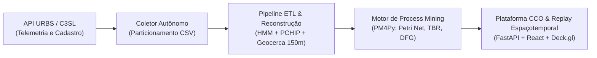

# Capítulo 3 — Metodologia e Engenharia de Dados

Este capítulo formaliza a metodologia científica e os procedimentos de engenharia de dados empregados para transformar registros brutos e esparsos de rastreamento veicular (GPS) em um registro de eventos (*event log*) de alta fidelidade para Mineração de Processos (*Process Mining*). A abordagem aqui documentada reflete o pipeline efetivamente desenvolvido, superando formulações simplistas de junção espacial direta ao incorporar projeção topológica probabilística por Modelos Ocultos de Markov (*Hidden Markov Models* — HMM), interpolação temporal por splines hermitianos monotônicos (PCHIP), filtragem geométrica vinculada à malha viária oficial e auditoria operacional em plataforma integrada.

---

## 3.1 Visão Geral da Arquitetura da Solução

A solução proposta estrutura-se como um pipeline modular de ponta a ponta dividido em cinco estágios complementares:

1. **Obtenção e Acesso aos Dados da API da URBS:** Estabelecimento do canal formal com o órgão gestor do transporte municipal para obtenção dos endpoints e catálogo de dados abertos.
2. **Aquisição Contínua e Armazenamento:** Coleta autônoma 24/7 de telemetria dinâmica via API REST da URBS em diferentes cadências amostrais, associada à carga de dados cadastrais estáticos históricos via C3SL/UFPR.
3. **ETL e Reconstrução de Trajetórias:** Higienização de dados, rejeição de *outliers* com restrição viária no *shape*, segmentação semântica de viagens (*cases*), *map matching* com HMM/Viterbi, interpolação PCHIP e controle de qualidade via Taxa de Censura Operacional.
4. **Mineração de Processos (Motor PM4Py):** Execução dos algoritmos de descoberta indutiva (*Inductive Miner* com Redes de Petri), verificação de conformidade (*Token-Based Replay* com cálculo de *Trace Fitness*) e análise de desempenho temporal (*Directly-Follows Graph* — DFG).
5. **Plataforma Integrada de Auditoria Operacional:** Ambiente web reativo desacoplado (backend FastAPI e frontend React/Deck.gl v9) dotado de visão macro (Auditoria Diária CCO), visão micro (Inspetor de Conformidade) e replay espaçotemporal da frota.

A Figura 3.1 ilustra a arquitetura conceitual e o fluxo de dados entre os componentes do pipeline.

---

## 3.2 Obtenção e Acesso aos Dados da API da URBS

A viabilização desta pesquisa demandou interlocução inicial direta com o corpo técnico e administrativo da Urbanização de Curitiba S/A (URBS), responsável pelo gerenciamento da Rede Integrada de Transporte (RIT). 

Por meio de solicitações formais via correio eletrônico e protocolos acadêmicos institucionais, foram requeridos:
- O acesso irrestrito aos serviços de disponibilização de dados em tempo real da frota de ônibus;
- O dicionário de dados atualizado dos campos emitidos pelo Sistema de Controle Operacional (SCO);
- A especificação das chaves de integração entre o cadastro estático de planejamento (linhas, paradas, tabelas horárias e traçados) e a telemetria emitida pelos computadores de bordo dos veículos operacionais.

Com a autorização institucional, mapeou-se a topologia dos endpoints de telemetria (`getVeiculos.php`, `getLinhas.php`, `getPontosLinha.php`, `getTabelaLinha.php` e `getShapeLinha.php`), viabilizando a automação de consultas sistemáticas sem ônus à infraestrutura operacional do município.

---

## 3.3 Coleta Contínua e Protocolo dos Regimes Operacionais

Para alimentar a pesquisa com um histórico representativo de dados de campo, desenvolveu-se um módulo coletor em linguagem Python (`src/coleta/coletor_urbs.py`). O coletor foi arquitetado com tratamento assíncrono de exceções de conexão, renovação de sessões HTTP e tolerância a quedas temporárias de rede. Os dados recebidos são gravados em disco estruturados hierarquicamente por data e hora no padrão `data/dados_em_tempo_real_2026/YYYY-MM-DD/YYYY-MM-DD_HH-00.csv`, onde cada registro agrega as leituras instantâneas da frota ao atributo temporal de requisição (`request_timestamp`).

Para fins de avaliação metodológica e análise de sensibilidade do pipeline, o estudo estabeleceu duas campanhas empíricas de coleta distintas, denominadas **Regimes Operacionais**:

1. **Regime A (Amostragem Padrão da Rede):**
   - Período contínuo: de 24/10/2025 às 02:32:48 até 29/10/2025 às 12:29:23 (~130 horas).
   - Intervalo nominal entre amostras: aproximadamente 120 segundos (~2 minutos).
   - Volume total: 5.082.166 registros de GPS brutos capturados para toda a frota municipal, divididos em 127 arquivos horários.
2. **Regime B (Alta Frequência Operacional):**
   - Período contínuo: de 02/12/2025 às 00:03:05 até 08/12/2025 às 23:27:09 (~167 horas / 7 dias completos).
   - Intervalo nominal entre amostras: aproximadamente 20 segundos.
   - Volume total: amostragem em alta densidade consolidada em logs de eventos específicos por linha (e.g., 16.822 eventos de parada e 1.200 viagens completas para a linha troncal 541).

Os dados cadastrais e estáticos de suporte — sequências oficiais de paradas (`pontosLinha`), escalas de horários e itinerários (`tabelaLinha`) e a geometria física vetorial das vias (`shapeLinha`) — foram consolidados a partir do espelho histórico arquivado pelo Centro de Computação Científica e Software Livre (C3SL) da UFPR (`data/dados_c3sl`), com rotina de contingência (*fallback*) consultando a API ativa da URBS e persistindo cópias de segurança em cache local (`data/static_cache`).

---

## 3.4 Pré-processamento e Filtragem com Restrição na Malha Viária (*Shape*)

Os dados brutos de telemetria sofrem de imperfeições inerentes ao sensoriamento em ambientes urbanos (*cânions urbanos*, reflexões multipercurso e paradas prolongadas em semáforos). O módulo `clean_telemetry` aplica seis filtros sequenciais para cada veículo:

1. **Expurgo de Nulos:** Descarte de registros com latitude, longitude, identificador de veículo (`COD`) ou timestamp ausentes.
2. **Filtro de Deslocamento Morto (Garagem):** Eliminação de registros marcados com o código de situação de recolhimento (`SITUACAO == 'REC'`), garantindo que apenas trajetórias comerciais em serviço público componham a base.
3. **Sanitização Operacional:** Remoção de tuplas com estados operacionais indefinidos ou conflitantes de sentido (`SENT`).
4. **Deduplicação Exata:** Descarte de leituras redundantes com mesmo par $(\text{veículo}, \text{timestamp})$.
5. **Supressão de Jitter Estacionário:** Descarte de amostras consecutivas cuja distância euclidiana seja inferior a 5 metros, evitando sobrecarga com veículos imobilizados em pontos de controle.
6. **Filtro de Outliers com Restrição Viária (*Shape Buffer*):** Em abordagens clássicas de *geofencing*, pontos de GPS eram validados exclusivamente pela proximidade às paradas fixas, o que causava o descarte indevido de leituras válidas em vias expressas longas onde paradas consecutivas distam mais de 1 km. A metodologia implementada calcula a menor distância ortogonal de cada leitura GPS $(lat, lon)$ em relação aos segmentos contínuos que compõem o traçado físico da linha (`shapeLinha`):

$$d_{\min}(p, \text{Shape}) = \min_{s \in \text{ShapeSegments}} \text{dist}_{\text{Haversine}}(p, s)$$

Apenas leituras cuja distância $d_{\min}$ exceda o limiar de tolerância de 500 metros são classificadas como desvios anômalos espúrios e expurgadas.

---

## 3.5 Reconstrução de Trajetórias e Geração do Log de Eventos

A transformação de pings de coordenadas contínuas $(x, y, t)$ em eventos discretos de processo obedece a uma formulação rigorosa composta por quatro subestágios matemáticos (`src/etl/trajectory.py`).

### 3.5.1 Segmentação Semântica de Viagens (*Cases*)

Para a Mineração de Processos, cada instância de processo (*case*) deve corresponder a uma viagem direcional completa e ininterrupta. Os dados pré-processados de cada veículo são ordenados cronologicamente e particionados nas seguintes condições de contorno:
- Inversão explícita da chave de sentido cadastral (`SENT` variando entre IDA e VOLTA);
- Lacuna de inatividade temporal (*gap*) superior a 10 minutos sem transmissão de telemetria;
- Mudança do código da tabela de escala diária vinculada ao veículo.

Cada viagem recebe uma chave identificadora única estruturada:
$$\text{case:concept:name} = \text{\{veículo\}\_\{linha\}\_\{tabela\}\_\{data\}\_\{sentido\}\_V\{índice\}}$$

### 3.5.2 Projeção Espacial HMM/Viterbi sobre o Traçado Físico

Com o trajeto segmentado, cada coordenada observada de GPS $z_k$ é associada à sua projeção no traçado físico $\text{shapeLinha}$ por meio de um Modelo Oculto de Markov (*Hidden Markov Model* — HMM), solucionado de forma ótima pelo algoritmo de Viterbi (Newson e Krumm, 2009).

- **Probabilidade de Emissão:** Modela o erro de medição do sensor GPS como uma distribuição gaussiana de desvio padrão $\sigma_z = 30\text{ m}$:
$$p(z_k | x_k) = \frac{1}{\sqrt{2\pi}\sigma_z} \exp\left(-\frac{\text{dist}_{\text{greatcircle}}(z_k, x_k)^2}{2\sigma_z^2}\right)$$

- **Probabilidade de Transição:** Avalia a plausibilidade do deslocamento ao longo da malha física, penalizando a discrepância entre a distância linear e a distância acumulada na via através de distribuição exponencial com escala $\beta = 50\text{ m}$:
$$p(x_{k+1} | x_k) = \frac{1}{\beta} \exp\left(-\frac{|\text{dist}_{\text{greatcircle}}(z_k, z_{k+1}) - \Delta s_{\text{shape}}(x_k, x_{k+1})|}{\beta}\right)$$

A sequência ótima de estados maximiza o caminho de verossimilhança global, devolvendo a coordenada curvilínea unidimensional acumulada $s$ para cada ponto do trajeto.

### 3.5.3 Estimação Temporal Monotônica via PCHIP e Limiar de Geocerca (150m)

A partir das coordenadas curvilíneas projetadas e seus respectivos instantes de tempo observados $(s_k, t_k)$, é necessário estimar o timestamp exato de passagem do veículo pelo ponto quilométrico $s_{\text{parada}}$ de cada estação de embarque.

Para evitar os conhecidos problemas de *overshoot* e anomalias de causalidade temporal associados a splines cúbicos tradicionais (onde acelerações artificiais podem gerar $dt/ds < 0$), adota-se o interpolador **PCHIP** (*Piecewise Cubic Hermite Interpolating Polynomial*). O PCHIP preserva estritamente a monotonicidade dos dados, garantindo derivadas locais contínuas e não-negativas:

$$\frac{dt}{ds} \ge 0, \quad \forall s$$

**Tratamento de Omissões (Detecção de Paradas Puladas):**
A fim de permitir que o módulo de conformidade audite infrações operacionais com fidelidade, a interpolação só é admitida se a trajetória física observada do ônibus registrar uma aproximação espacial mínima inferior a 150 metros em relação ao ponto fixo de parada:

$$\text{dist}_{\min}(\text{Viagem}, \text{Parada}) \le 150\text{ metros}$$

Caso o veículo contorne a parada por rota alternativa ou trafegue a uma distância superior a 150 metros, o evento é **deliberadamente omitido** do registro de eventos daquela viagem. Dessa forma, a ausência do evento reflete a violação da escala de atendimento, permitindo que os algoritmos de conformidade apontem a irregularidade.

### 3.5.4 Padronização com Chaves Canônicas, Metadados e Taxa de Censura

Para eliminar ambiguidades em rotas circulares ou vias onde a URBS atribui denominações idênticas a paradas consecutivas (o que induziria falsos laços repetitivos no grafo de processos), instituiu-se o padrão de chave canônica de atividade:

$$\text{concept:name} = \text{PASSAGEM\_\{SEQ:02d\}\_\{NOME\_DA\_PARADA\}}$$

Adicionalmente, cada evento é enriquecido com atributos contextuais:
- `interpolated: bool` — flag booleana que sinaliza quando o evento foi obtido por aproximação temporal (ping mais próximo a mais de 100m da parada), garantindo que medições de tempos de ciclo e atrasos considerem a incerteza do dado;
- `distance: float` — distância física real mais próxima mensurada pelo GPS.

**Taxa de Censura Operacional:**
Viagens gravemente corrompidas por falhas no aparelho de telemetria (e.g., transmissões com menos de 3 leituras válidas ou com proporção de eventos interpolados superior a 90%) são sumariamente censuradas e descartadas do pipeline de mineração. Essa barreira impede que dados sem lastro físico distorçam as métricas de conformidade e desempenho.

---

## 3.6 Estruturação e Exportação do Log de Eventos

Os eventos resultantes são consolidados segundo as especificações internacionais de Mineração de Processos preconizadas pela norma **IEEE 1849-2016 (OpenXES)**.

O log é exportado em dois formatos interoperáveis em `data/dados_processados/`:
1. **Padrão CSV:** Tabela canônica ordenada por `case:concept:name` e `time:timestamp`, otimizada para ingestão em bibliotecas analíticas relacionais (`pandas`, `duckdb`).
2. **Padrão XES (Extensible Event Stream):** Estrutura hierárquica em XML serializada pelo PM4Py contendo declarações formais de classificadores globais de caso e evento, tipos primitivos estritos e extensões semânticas (*Concept, Time, Organizational*).

A Tabela 3.1 sumariza o esquema do log de eventos gerado.

| Coluna / Atributo XES | Tipo de Dado | Descrição Funcional no Process Mining |
| :--- | :--- | :--- |
| `case:concept:name` | String | Identificador do caso (viagem comercial unívoca) |
| `concept:name` | String | Nome canônico da atividade (`PASSAGEM_{SEQ}_{NOME}`) |
| `time:timestamp` | Datetime (ISO 8601) | Instante de passagem estimado com precisão de milissegundos |
| `org:resource` | String | Recurso operacional executor (código do prefixo do ônibus) |
| `tabela` | String | Escala horária de trabalho programada pela URBS |
| `gps_direction` | String | Sentido operacional auditado (IDA ou VOLTA) |
| `interpolated` | Boolean | Sinalizador de incerteza de sensoriamento |
| `distance` | Float | Distância de aproximação física observada (metros) |

---

## 3.7 Arquitetura da Plataforma Integrada de Auditoria Operacional

Para transpor os achados analíticos do campo acadêmico para o ambiente operacional de fiscalização, desenvolveu-se uma plataforma web integrada concebida sob os preceitos de arquitetura desacoplada:

- **Backend Analítico (FastAPI):** Exponibiliza endpoints REST em alta velocidade para consulta de métricas agregadas e integra diretamente a suíte de algoritmos do PM4Py. O processamento assíncrono de re-mineração sob demanda utiliza canais *Server-Sent Events* (SSE) na rota `/api/process-stream`, fornecendo atualizações do log de execução em tempo real para o usuário sem bloqueio de interface.
- **Frontend Interativo (React + TailwindCSS + Vite):** Interface modular orientada a componentes especializada em quatro frentes de análise:
  - *Auditoria Diária CCO:* Módulo de governança executiva com indicadores consolidados da frota e tabela com classificação multicritério de linhas operacionais em três faixas de criticidade (**Conforme**, **Atenção** e **Crítico**);
  - *Inspetor de Conformidade:* Avaliação de *Trace Fitness* individualizado e listagem de viagens transgressoras com maior índice de paradas suprimidas;
  - *Descoberta e Desempenho:* Renderização interativa e responsiva de modelos de Redes de Petri e DFGs com controle de zoom vetorial via `svg-pan-zoom`;
  - *Replay Geoespacial 4D:* Console cartográfico baseado no framework **Deck.gl v9** (`TripsLayer` e `TextLayer`), projetando as viagens diretamente sobre a malha física viária e sincronizando a posição de dezenas de veículos simultâneos com interpolação linear dinâmica vinculada a um slider temporal contínuo (00:00 às 24:00).

---

## 3.8 Protocolo de Validação e Testes Automatizados

A confiabilidade do software, a reprodutibilidade dos experimentos e a integridade matemática dos algoritmos são asseguradas por uma suíte de **82 testes automatizados** implementados sob o framework `pytest`. A bateria de testes abrange:

- **10 Testes de Reconstrução de Trajetória (`test_trajectory_reconstruction.py`):** Validação de projeção ortogonal, garantia de monotonicidade estrita do PCHIP, omissão de paradas fora do limiar de 150m e tratamento de bifurcações de rota;
- **8 Testes do Motor de Process Mining (`test_process_mining_engine.py`):** Aderência dos formatos de logs, convergência de Redes de Petri do Inductive Miner e estabilidade de cálculo do *Token-Based Replay*;
- **3 Testes de Repositório de Telemetria (`test_telemetry_repository.py`):** Tratamento de codificação de caracteres (*mojibake*), persistência de dados em disco e resolução de sentidos operacionais;
- **61 Testes End-to-End da API do Dashboard (`test_dashboard_e2e.py`):** Verificação de contratos de endpoints REST, serialização de grafos vetoriais, integridade do streaming SSE e integridade do cálculo da Auditoria Diária CCO.

Essa infraestrutura de testes contínuos garante que todas as evidências apresentadas nos capítulos subsequentes repousem sobre bases algorítmicas matematicamente consistentes e plenamente auditáveis.